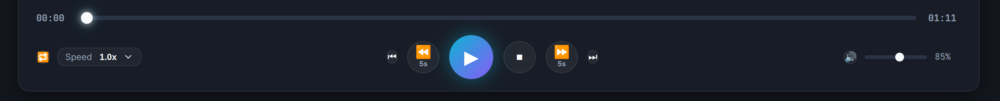
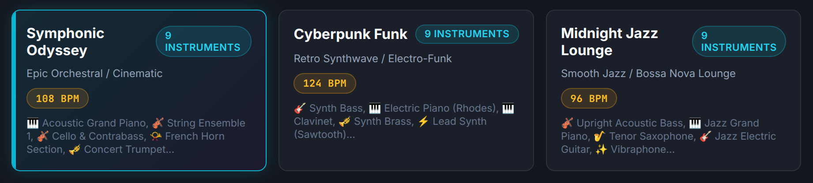
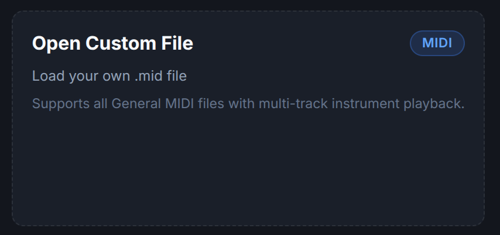
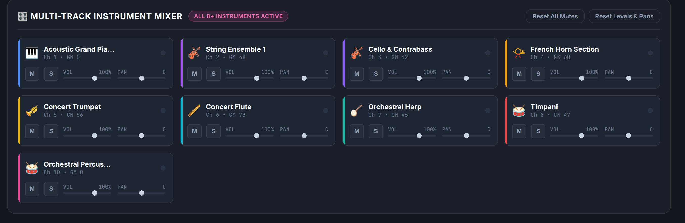
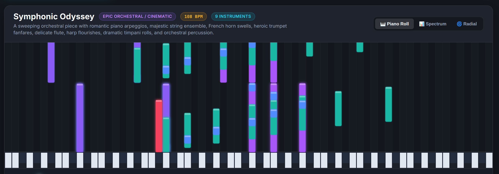

# 🎹 Neon MIDI Studio Player

A multi-instrument Web Audio MIDI player built with pure HTML5, CSS3, and vanilla modern JavaScript (zero external runtime dependencies).

---

## 🚀 Quick Start

### Option 1: Run the local server (Recommended)
```bash
python3 server.py 8080
```
Then open your browser at **[http://localhost:8080](http://localhost:8080)**.

### Option 2: Open directly in any browser
Open `index.html` directly in Google Chrome, Firefox, Safari, or Microsoft Edge. All preloaded songs and audio synthesizers work 100% offline with zero dependencies!

---

## 🎵 Features


### 1. Full Player Transport Controls



- **Play / Pause**: Large center glowing button or <kbd>Space</kbd>.
- **Stop**: Immediately stops audio, silences active voices, and resets playhead to `00:00` (<kbd>S</kbd>).
- **Rewind (REV)**: Skips backward by 5 seconds with instant audio resync (<kbd>←</kbd> or <kbd>J</kbd>).
- **Forward (FWD)**: Skips forward by 5 seconds (<kbd>→</kbd> or <kbd>L</kbd>).
- **Previous / Next Track**: Cycle across the 3 generated songs (<kbd>P</kbd> / <kbd>N</kbd>).
- **Scrubbable Seekbar**: Real-time progress bar with time indicators (`MM:SS`).
- **Speed Selector**: 0.5x, 0.75x, 1.0x, 1.25x, 1.5x.
- **Repeat Loop**: Continuous loop playback (<kbd>R</kbd>).
- **Master Volume & Mute**: Slider (0% to 150%) with dynamic speaker icon (<kbd>M</kbd>, <kbd>↑</kbd>, <kbd>↓</kbd>).

### 2. Three Multi-Instrument MIDI Songs (Generated at your discretion)



Each song features **at least 8 distinct instruments** (9 active musical tracks each):

| Song | Genre | BPM | Featured Instruments (9 tracks) |
| :--- | :--- | :---: | :--- |
| **1. Symphonic Odyssey** | Epic Orchestral / Cinematic | 108 | 1. Acoustic Grand Piano<br>2. String Ensemble 1<br>3. Cello & Contrabass<br>4. French Horn Section<br>5. Concert Trumpet<br>6. Concert Flute<br>7. Orchestral Harp<br>8. Timpani<br>9. Orchestral Percussion |
| **2. Cyberpunk Funk** | Retro Synthwave / Electro-Funk | 124 | 1. Synth Bass (Slap)<br>2. Electric Piano (Rhodes)<br>3. Clavinet<br>4. Synth Brass<br>5. Lead Synth (Sawtooth)<br>6. Synth Pad (Warm)<br>7. Marimba<br>8. Poly Synth (Square)<br>9. Electronic Funk Drums |
| **3. Midnight Jazz Lounge** | Smooth Jazz / Bossa Nova | 96 | 1. Upright Acoustic Bass<br>2. Jazz Grand Piano<br>3. Tenor Saxophone<br>4. Jazz Electric Guitar<br>5. Vibraphone<br>6. Jazz Flute<br>7. Drawbar Organ (Hammond B3)<br>8. Muted Trumpet<br>9. Jazz Drums (Brushes/Ride) |

### 3. Open Custom MIDI Files



- **File Picker**: Click `📁 Open MIDI` to select any `.mid` or `.midi` file from your computer.
- **Drag & Drop**: Drag any MIDI file anywhere onto the browser window.
- **Save / Export**: Click `💾 Download .MID` to save the active song file to your hard drive.

### 4. Multi-Track Instrument Rack & Mixer



- Dedicated channel strip for each of the active instruments.
- **Live LED Activity Meter**: Glows in real time when notes are sounding on that instrument.
- **Mute (M)** and **Solo (S)** toggles per instrument.
- **Volume Fader** (0% to 150%) per instrument.
- **Stereo Pan Knob** (L 100% to R 100%) per instrument.

### 5. Multi-Mode Canvas Visualizer



- **Piano Roll View**: Falling notes display with active 88-key virtual piano keyboard, color-coded per instrument.
- **Spectrum Analyzer**: Real-time 64-band FFT audio spectrum with peak meters and oscilloscope waveform overlay.
- **Radial Cyberpunk**: Circular pulsing frequency visualizer.

---

## ⌨️ Keyboard Shortcuts

| Key | Action |
| :--- | :--- |
| <kbd>Space</kbd> | Play / Pause |
| <kbd>S</kbd> | Stop |
| <kbd>←</kbd> or <kbd>J</kbd> | Rewind 5 seconds |
| <kbd>→</kbd> or <kbd>L</kbd> | Forward 5 seconds |
| <kbd>↑</kbd> / <kbd>↓</kbd> | Volume Up / Down |
| <kbd>M</kbd> | Toggle Mute |
| <kbd>R</kbd> | Toggle Loop |
| <kbd>1</kbd>, <kbd>2</kbd>, <kbd>3</kbd> | Switch to Song 1, 2, or 3 |
| <kbd>O</kbd> | Open MIDI file dialog |

---

## 🛠️ Technical Architecture

- **`midi-parser.js`**: Pure JavaScript binary SMF Type 0 and Type 1 parser. Handles variable-length quantities (VLQ), tempo maps, microseconds-to-seconds conversion, and running status.
- **`synth-engine.js`**: Web Audio polyphonic GM synthesizer. Implements custom acoustic modeling, physical modeling, FM synthesis, multi-saw detuned unison, resonant filters, algorithmic concert hall reverb, master compressor/limiter, and FFT analyser.
- **`player.js`**: Lookahead event scheduler ensuring sample-accurate note timing immune to main thread delays, with seek/transport synchronization.
- **`visualizer.js`**: 60 FPS HTML5 Canvas engine supporting Piano Roll, Spectrum, and Radial modes.
- **`generate_songs.py`**: Python MIDI file generator producing standard SMF Type 1 `.mid` files with complete counterpoints, harmonies, and drum tracks.
